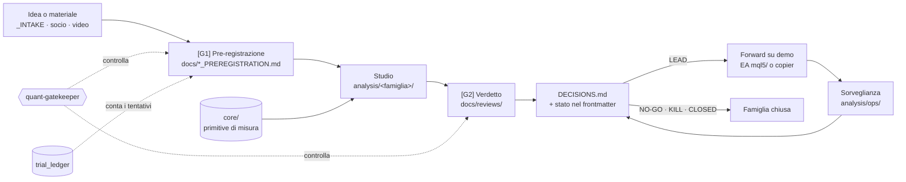
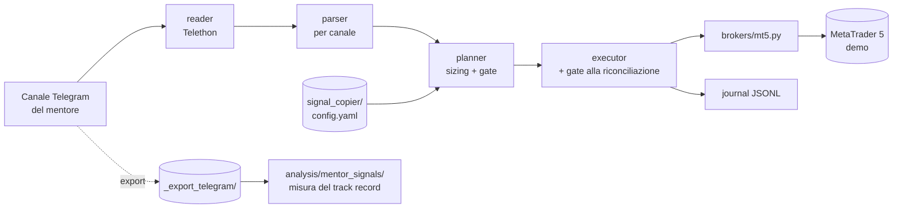

# Mappa di trad — panoramica e percorso

`trad` è il progetto di ricerca quant: un **metodo** per decidere se un'idea di trading merita
capitale, gli **strumenti** che lo rendono misurabile, e i pochi **sistemi** che girano davvero.
Questa nota è la porta d'ingresso. Ogni componente ha la sua nota, scritta leggendo il codice
vero. La mappa dell'hub (Sync, backup, filtri) è a parte: [[mappa/00-panoramica|panoramica dell'hub]].

## Obiettivo e risalita (30/09/2026)

```
"Matteo ha domestichezza completa con trad: sa cosa fa ogni parte, come si usa, come si rompe"
  ← comprensione VERIFICATA componente per componente (campo `compreso` + metodo)
    ← una nota per componente, che cita i file reali
      ← questa panoramica: come i componenti si collegano
        ← un CATASTO COMPLETO: ogni cartella e ogni doc assegnati a un componente
          (senza catasto "tutto" non è misurabile: non sapremmo quando abbiamo finito)
```

## Il sistema in due figure

**1. Il loop di ricerca: come un'idea diventa una decisione.** Metodo:
`docs/STRATEGY_LIFECYCLE.md` §1.



**2. La catena che tocca soldi: i segnali del mentore.** Era l'unico edge `CONFERMATO`; dal 02/10 è
`IN REVISIONE` perché il canale cancella i segnali perdenti e lo storico è selezionato (frontmatter di
`docs/MENTOR_SIGNALS_OOS_PREREGISTRATION.md`). Si rimisura sul forward del copier: il **journal** è
l'unico registro non selezionato, l'export Telegram no.



**Dove agisce il gate anti-ritardo (dal 30/09).** Il mentore apre sul messaggio "NOW", prima di
postare l'entrata: il copier entra a mercato con un bracket provvisorio e, al messaggio coi livelli,
**riconcilia**. Il gate (20 pip, solo lato sfavorevole: `planner.late_gate`) agisce quindi in due
punti: nel **planner** per i canali che postano tutto in un messaggio, e nell'**executor alla
riconciliazione** per il mentore, dove se scatta **chiude le gambe a mercato**. Prima del 30/09 sul
mentore non agiva mai ([review del 30/09](../docs/reviews/analysis_team_live_2026-09-30.md) §4).

## Catasto: dove sta ogni cosa

Censimento del 30/09/2026 con `git ls-files` e l'analisi degli import di tutti i 179 file `.py`
(circa 31.000 righe). **Stato**: *vivo* = usato o modificato nell'ultimo mese; *sorveglianza* =
fermo ma legato a qualcosa che gira; *dormiente* = funziona ma non è usato; *archivio* = storia.

| Cartella / file | Cosa contiene | Componente | Stato |
|---|---|---|---|
| `docs/STRATEGY_LIFECYCLE.md`, `docs/QUANT_REVIEW_PROTOCOL.md`, `docs/EARLY_STAGE_AUDIT_*`, `docs/BACKLOG_RICERCA.md`, `docs/trial_ledger.json` | il metodo | 1 · ciclo di vita e gate | vivo |
| `docs/*_PREREGISTRATION.md`, `DECISIONS.md`, `docs/reviews/`, `docs/README.md`, `mappa/_cruscotto.base` | stato e storia delle decisioni | 2 · stato canonico | vivo |
| `signal_copier/` (configurazione propria in `signal_copier/config.yaml`), `docs/COPIER_EXECUTION_PREREGISTRATION.md` | copia dei segnali Telegram → MT5 | 3 · signal copier | vivo (demo dal 21/09) |
| `mql5/`, `analysis/ops/`, `docs/health/`, `docs/FADE_LIVE_AUDIT_PROTOCOL.md` | Expert Advisor e loro sorveglianza | 4 · EA e VPS | sorveglianza |
| `analysis/mentor_signals/`, `analysis/{mentor_entries,mentor_momentum,export_dataset,probe_mt5}.py`, `docs/MENTOR_*`, `docs/PROP_FIRM_CRITERIA.md`, `_export_telegram/` (dati, fuori da git) | misura del track record del mentore | 5 · segnali mentore | vivo |
| `core/` (tranne runner, registry, regime, prop_sim, sizing), `core/tests/`, `config/risk.yaml` (letto da `core/risk_gate.py`) | primitive di misura e gate di rischio delle strategie meccaniche | 6 · primitive | vivo |
| `analysis/trend/`, `docs/TREND_*`, `docs/B2_KICHEV_POTENZA.md` | uno studio completo, usato come esempio | 7 · anatomia di uno studio | vivo |
| `analysis/{level_research,nxt,opening_range,meanrev,round_grid,extension,trading-bot-eval,veltrix,forexgump}/`, `strategies/{tsmom,meanrev,seasonality}/`, i restanti `docs/*` di famiglia (`LEVEL_RESEARCH_PLAN`, `NXT_EXIT_CEILING_ADDENDUM`, `B3_*`) | tutte le famiglie studiate | 8 · catalogo delle famiglie | archivio, tranne `forexgump` (vivo) |
| `fondamenti_tecnici/`, `analysis/intake/`, `materiale_socio/`, `TRADING_PRINCIPLES.md` | conoscenza distillata e porta del materiale nuovo | 9 · conoscenza e intake | vivo |
| `CLAUDE.md`, `.claude/`, `agents/`, `skills/`, `memoria/trad/` (nell'hub) | come lavora Claude su trad | 10 · Claude in trad | vivo (`agents/` e `skills/` alla radice: da chiarire) |
| `pyproject.toml`, `conftest.py`, `tests/`, `config/markets.yaml`, `config/README.md`, `.env.example`, `.gitignore`, `data/`, `CONVENTIONS.md` | ambiente, test, configurazione | 11 · ambiente e test | vivo |
| `core/{runner,registry}.py`, `strategies/{_base,_template,confluence_levels,confluence_auto}/`, `notifiers/`, `brokers/` (tranne mt5), `backtesters/`, `level_analyzer/`, `journals/`, `docs/{ARCHITECTURE_v2,STAGE2_TESTING_PLAN,OPERATIONAL_GUIDE,TRADING_WORKFLOW_DESIGN,PYTHON_FILES_MAP}.md`, `PROJECT.md`, `ROADMAP.md`, `README.md` | l'architettura di maggio–giugno (pre e post pivot) | 12 · sistemi dormienti | dormiente |
| `strategies/stock_selector/`, `core/regime.py`, `docs/INVESTING_PILLAR_PLAN.md`, `docs/INVESTMENT_ALGO_DESIGN.md`, `stoxs picks/` | investimento passivo e il vecchio selettore di azioni | 13 · investing | archivio (selettore), vivo (PAC) |
| `prop-lab/` (repo condiviso col socio VELTRIX, allineato con `prop-lab/CHANGELOG.md`), `core/prop_sim.py`, `core/sizing.py` | simulatore di challenge prop, pipeline di famiglia del socio, doppio binario della gestione del rischio | 14 · prop-lab e doppio binario | vivo (dal 06/10) |
| `mappa/` | questa mappa, il cruscotto e il registro modifiche di trad | — | vivo |
| `backtest_results/`, `logs/`, `output/`, `socio-trading-bot/` | risultati e materiale locale, quasi tutto fuori da git | — | dati |

**Moduli condivisi tra componenti:** `brokers/mt5.py` (3 e 4), `notifiers/_pip_table.py` (3 e 5),
`core/quant_metrics.py` (usato da 22 file di ricerca), `core/risk_gate.py` (6 e 12: lo usano
`core/runner.py` e `confluence_levels`, **non** il copier).

**Da sapere prima di iniziare:** `docs/PYTHON_FILES_MAP.md` è una mappa vecchia, ferma al 02/06 e
già marcata incompleta dal 27/08. Il suo posto lo prende questo catasto.

## Il percorso

Prima ciò che tocca **soldi e decisioni**, poi gli strumenti, poi la storia. Ritmo del piano:
2 componenti a settimana. Metodi di verifica: **spiegazione** (scrivi *con parole mie*, Claude
confronta con il codice), **quiz**, **guasto simulato** (Claude introduce un guasto realistico su
un branch e tu lo trovi).

| # | Componente | Perché a questo punto | Verifica |
|---|---|---|---|
| 0 | questa panoramica | la cornice di tutto il resto | spiegazione |
| 1 | ciclo di vita e gate | è la regola che decide cosa riceve capitale | spiegazione |
| 2 | stato canonico e DECISIONS | è dove nasceva il "mescola versioni" | guasto simulato |
| 3 | signal copier | gira in demo, domani con soldi veri | guasto simulato |
| 4 | EA e VPS | ciò che gira sul VPS lo si verifica in MT5, non nel repo | guasto simulato |
| 5 | segnali mentore | l'unico edge confermato: come è stato misurato | spiegazione |
| 6 | primitive di misura | le regole diventate codice (fill, baseline, dati, trial) | spiegazione + quiz |
| 7 | anatomia di uno studio | come si legge una qualsiasi cartella di `analysis/` | spiegazione |
| 8 | catalogo delle famiglie | cosa è già stato provato, e perché non si riapre | quiz |
| 9 | conoscenza e intake | da dove entrano idee e fonti | spiegazione |
| 10 | Claude in trad | istruzioni, agenti, memoria | quiz |
| 11 | ambiente e test | come si lancia e come si controlla che funzioni | quiz |
| 12 | sistemi dormienti | cosa c'è ma non gira, e perché non va toccato a caso | quiz |
| 13 | investing | PAC e selettore archiviato | quiz |
| 14 | prop-lab e doppio binario | il simulatore prop e la regola dei due binari, arrivati il 06/10: [[14-prop-lab-e-doppio-binario]] | spiegazione |

**A che punto sei** non si scrive qui: sta nel campo `compreso` del frontmatter di ogni nota, e il
cruscotto (`mappa/_cruscotto.base`, vista *Comprensione*) lo raccoglie da solo.

## Con parole mie

